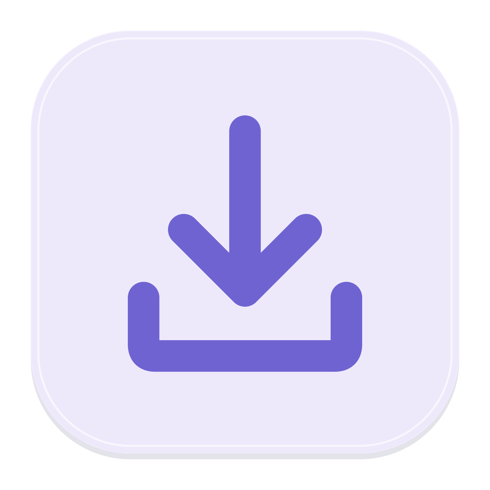

<p align="center"></p>
<h1 align="center">LinkParse</h1>
<p align="center">動画の中身を、次の創作へ。</p>

[简体中文](README.md) · [English](README.en.md) · [日本語](README.ja.md) · 製品ページ

LinkParse は macOS 向けのローカルメディア抽出ツールです。単一動画の共有リンクを貼り付けるか、ローカルファイルを読み込み、音声・画面内の文字・音声ファイル・フレームを再利用できる形で書き出します。

**macOS · ローカル開発版 · Rust + macOS ネイティブホスト**

ここでの製品名は LinkParse です。ソースコード、アプリ名、コマンドには現在 LinkParsing / `linkparsing` を使用しています。

## 機能

- **リンクとローカルファイル** — YouTube・抖音（Douyin）・Bilibili の単一動画用解析／ダウンロードアダプター。ダウンロード済みフォルダの再読み込みにも対応。
- **音声の文字起こし** — ローカル Whisper でタイムラインを生成し、TXT・Markdown・SRT で書き出し。エンジンとモデルの別途導入が必要です。
- **画面内の文字** — Apple Vision による間隔サンプリング OCR。音声の文字起こしとは別に保存します。全フレームの字幕抽出ではなく、校正が必要です。
- **個別の書き出し** — テキスト、MP3/WAV、PNG フレーム、全長のソース動画。ソース動画は選択範囲に関係なく、ダウンロード・結合後の全長とバイト列を保持します。
- **ローカル作業** — 保存先の選択、キャンセル、素材の再生、結果の確認。ブラウザーのログイン情報は自動取得しません。

## 使い方

1. アプリを起動して保存先を選び、リンクを貼り付けるかローカルファイルを読み込みます。
2. 必要に応じて文字起こしや OCR を実行し、形式と時間範囲を選びます。
3. 選択したフォルダに書き出します。フレームとソース動画には、実際に素材を確認したうえでのウォーターマーク手動審査が必要です。

ダウンロード成功はウォーターマークなしの証明ではありません。不明またはマークありの場合、視覚ファイルの書き出しはブロックされます。テキストと音声は独立して処理できます。自動検出・除去機能ではありません。

[macOS ガイド（中国語）](docs/macos-launch.md) · [OCR ガイド（中国語）](docs/ocr.md) · [バックエンド・CLI（中国語）](backend/README.md)

## ソースから起動

macOS Xcode Command Line Tools、Rust、Python 3.10+、Node 22+、FFmpeg/ffprobe を事前にインストールし、プロジェクト直下で実行します。

```sh
python3 -m venv backend/.venv
backend/.venv/bin/python -m pip install -r backend/worker/requirements.lock
cargo run -p linkparsing-core -- doctor
./LP build
./LP
```

音声文字起こしを追加する場合（モデルをダウンロードして検証します）：

```sh
brew install whisper-cpp
python3 scripts/setup-asr.py
./LP build
```

現行版はローカルの ad-hoc 署名を使用し、ホスト環境に依存します。自己完結型の配布版、Developer ID 署名と公証、最低 macOS バージョン、他 OS での動作は未検証です。

## 現在の制限

- プラットフォームへのアクセスは認証・ネットワーク・地域・アクセス制限に左右されます。既存記録では Bilibili の単一サンプルは成功、YouTube は認証要求、抖音はレート制限でした。アダプター実装は全プラットフォームでの成功を保証しません。
- プレイリスト・ライブ・DRM コンテンツは非対応です。セッション内の素材は一つで、永続タスクキューやクラッシュ復旧はありません。
- Agent 要約、タスク DB、OS サンドボックスは未実装です。三言語の文書とサイトは、デスクトップ UI の三言語対応を意味しません。
- ASR/OCR はローカル処理です。ダウンロードとモデル導入にはネットワークが必要です。任意の公開 DNS フォールバックはユーザーが有効にした場合のみ、対象ドメインを Cloudflare に送信します。Cookie はユーザーが指定したファイルのみ使用します。
- 利用権限のある素材だけを処理してください。ソース動画はダウンロード・結合後のファイルで、投稿前のマスターではありません。

## 開発・検証

```sh
cargo fmt --all -- --check
cargo clippy --workspace --all-targets -- -D warnings
cargo test --workspace
backend/.venv/bin/python -m unittest discover -s backend/worker/tests -v
# FFmpeg / ffprobe / Python
cargo test --workspace --test media_smoke -- --ignored
cargo test --workspace --test download_flow -- --ignored
```

オフライン統合テストは合成素材と通信の代替実装を使用し、実サイトの受け入れ試験ではありません。デスクトップ・ASR・OCR の検証は macOS ガイドを参照してください。文書更新のたびに全検証を実行したという意味ではありません。

`backend/` コア · `desktop/` UI · `macos/` ネイティブホスト · `design/` デザイン · `website/` 三言語の製品ページ。

プレビューは website/README.md を参照。構成はローカル CallBridge を参考にし、本プロジェクトのアイコンとデザイン画像を使用しています。
